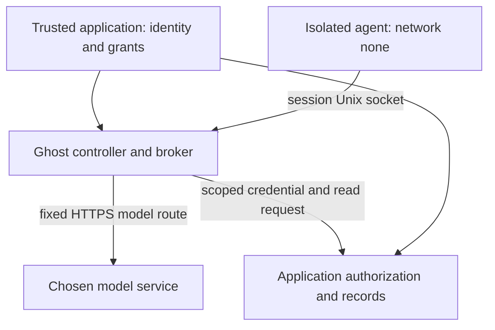

# Per-session model and read-tool broker (v0.5)

Implemented in `internal/broker`, integrated into the existing runtime/session
lifecycle. This is a deliberately small mediation boundary, not a general MCP
proxy, database firewall, tenant identity provider or compliance product.

## Trust boundary



Trusted `ghost.yaml` selects exact endpoints, model, schemas and resource grants.
No project marker, tool annotation, model answer or document creates permissions.
A new host broker belongs to exactly one Ghost session and is mounted into that
session alone through a UID-owned 0700 directory/0600 Unix socket. No host TCP
listener is opened. A read-only snapshot of the running static Ghost executable
provides a guest loopback bridge on `127.0.0.1:17871`; it has no upstream secrets.
The host validates the same rules if an agent bypasses this convenience bridge.
Actual Docker network mode and read-only/nonrecursive helper/socket mounts are
inspected before untrusted execution. Direct agent networking remains `none`;
combining a broker with the destination gateway/ASK is rejected.

Only an explicitly named host credential variable is read. Its value goes only
to that fixed TLS service, never into agent env/mounts, logs or durable evidence.
Guest `OPENAI_API_KEY=ghost-session` is a dummy compatibility value, ignored by
broker authorization. The trusted upstream itself receives its scoped credential
and is part of the trust boundary; do not use an untrusted credential recipient.
A broad admin/service token cannot substitute for application user authorization.

## Endpoint and model contract

Each endpoint is one HTTPS origin and port, without user info, path, query or
fragment. DNS resolves once at session creation, dialing only the selected numeric
address thereafter. TLS authenticates the configured name using system PKI, or
an explicit exact leaf-certificate SHA-256 plus name and validity dates. The latter
permits a controlled self-signed local service; it is not disabled verification.
Proxies, redirects, link-local/unspecified/multicast destinations and arbitrary
paths are rejected. An explicitly configured private/loopback endpoint grants
only that endpoint, never its surrounding network or a hostname supplied by an
agent. Operators control the endpoint trust decision; Ghost is not a network
location attestation service.

Only POST `/v1/responses` and `/v1/chat/completions` are exposed for one configured
model. Requests are text-only/stateless; `store` is forced false, non-false storage
requests and `previous_response_id` are denied. Known Codex cache/client metadata
is stripped. Hosted search/files/MCP/computer/image tools, remote media and
unsupported access programs are denied; only local function/custom tool schemas
are accepted. Ghost never interprets a local function description as permission.
A generic compatible server may retain data regardless of `store=false`; retention
and model/service quality remain operator responsibilities.

## Application read-tool contract

```yaml
broker:
  ttl_seconds: 600
  max_requests: 64
  application:
    url: https://application.example.test:9443
    credential_env: GHOST_EMPLOYEE_CAPABILITY
  tools:
    - name: documents.read
      effect: read
      parameters: {record_id: string}
      resource_argument: record_id
      resources: [case_A]
```

The agent sends POST `/ghost/tools/call`:

```json
{"id":"unique_call_1","name":"documents.read","arguments":{"record_id":"case_A"}}
```

Required properties only; scalar `string`, `integer` or `boolean`; null, nested
values, extra arguments, unknown tools and ungranted resources deny. Integers are
bounded to ±10000 and strings to 1024 bytes. At most 16 tools, 16 properties/tool
and 64 explicit resources/tool are configured. Tool names do not establish read
semantics: the **trusted application must implement `effect: read` as a real read**.
Writes, transactions and exactly-once remote effects are not supported.

The host forwards the validated name/effect/arguments with a newly generated
request ID to the fixed application `/ghost/tools/call`, supplying its own bearer
credential. Agent cookies/auth/tenant/identity fields are never forwarded. The
application must authenticate that credential, derive current user/tenant scope
and reauthorize **every** resource read at the data operation. Ghost's resource
allowlist is an additional ceiling, not the application's authorization system.
Application 401/403 fails closed. Permission withdrawal must be enforced there;
Ghost does not infer employee rights or store authoritative tenant grants.

Unique agent invocation IDs are consumed atomically before forwarding, including
uncertain failures; a replay never retries the same read. IDs are scoped to one
session and the bounded session request budget. Retrying with a new ID is a new
read and requires current application authorization.

## MCP subset

POST `/mcp` implements **2026-07-28** stateless `server/discover`, `tools/list`,
`tools/call`. Required per-request metadata, protocol/method/name header mirrors,
scalar request IDs, Accept types and Origin checks are enforced. Tool invocation
uses the same registry, schemas, resource grants, replay control and application
authorization above; no privileged upstream MCP server is blindly exposed.
The official Go SDK 1.8.0 is used as an independent interoperability client,
including inside real Ghost Docker execution. Legacy initialization/sessions,
notifications, subscriptions, MRTR, server sampling, writes and arbitrary MCP
servers are unsupported and fail closed. A client must use fresh request IDs
throughout a session. Protocol metadata never authenticates the employee.

## Budgets, containment, audit and recovery

Defaults: lifetime 3600 s (maximum), 128 requests (maximum 512), 4 active requests,
16 connections, burst 8/refill 2 requests/s, 1 MiB request/tool-response and 8 MiB
model response, 30 s call deadline and default 4096 output tokens (maximum 8192).
Rates/budgets include invalid calls. JSON duplicate keys, excessive depth/tokens
and trailing documents are rejected. JSON responses are bounded and validated
before release; SSE is bounded and cancelable, with already delivered bytes
irreversible. A failed broker/audit can end the session with an error.

Admission is durably recorded before forwarding. Ordered sentinel fencing and a
fresh authoritative containment check precede access; in-flight I/O is canceled
on observed containment/expiry (25 ms polling interval, not a hard real-time SLA).
Neither revocation nor cancellation undoes bytes/effects already accepted by a
remote service. Read-tool success is audited before releasing its result. Audit
failure revokes the broker. Existing SQLite events store only operation, decision,
host-generated correlated request ID/time and closed outcome codes, not prompts,
arguments/resource IDs, documents, URLs or credentials. These events remain visible
in `ghost inspect`; reconstruction must not invent content flow or model intent.

Shutdown cancels and joins handlers before sentinel finalization. Crash recovery
stops exactly owned Docker resources before validating/removing the session's
socket directory. Ambiguous markers/artifacts fail rather than trigger recursive
cleanup. No aggregate host quota, workspace disk quota, universal DLP, remote
transaction rollback, complete DoS prevention or independent security certification
is claimed. Separate projects require operator admission and retention controls.

References reviewed 2026-11-13:
[official MCP specification](https://modelcontextprotocol.io/specification/2026-07-28),
[official Codex source](https://github.com/openai/codex/tree/rust-v0.169.0),
[Claude programmatic execution](https://code.claude.com/docs/en/headless),
[Ollama API compatibility](https://docs.ollama.com/api/openai-compatibility),
[OWASP agent security guidance](https://cheatsheetseries.owasp.org/cheatsheets/AI_Agent_Security_Cheat_Sheet.html).
